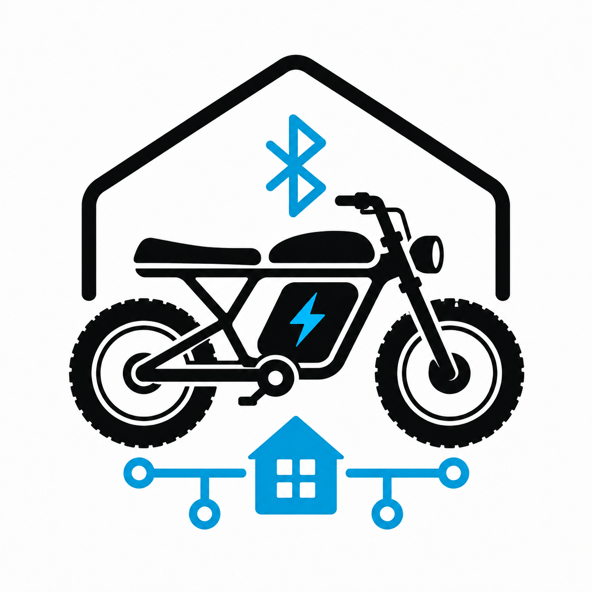

# SUPER73 Bluetooth for Home Assistant

<p align="center">
  
</p>

Read-only HACS custom integration for SUPER73 bikes and other Comodule Diamond
Display vehicles using the Bluetooth protocol documented by Walker73.

## Status

Current version: `0.2.0`

This is an early implementation intended for testing against a real bike. It:

- Discovers bikes exposing the metrics service UUID.
- Discovers likely SUPER73 bikes by advertised Bluetooth name.
- Allows manual setup by Bluetooth address.
- Connects every 10 seconds, reads the registers Walker73 decodes, and
  disconnects again.
- Exposes read-only sensors and binary sensors.

No write/control entities are exposed. The integration never changes the ride
mode, assist or light.

## Bluetooth connection

The bike accepts one Bluetooth connection at a time and stops advertising while
something is connected. So the integration doesn't keep a connection open: each
update connects, pairs (Just Works, or re-encrypts with the stored bond), reads,
and disconnects. The bike is only busy while an update is reading it and is
free for the official app or another controller the rest of the time.

If the bike is busy with another device, switched off, or away, the update is
skipped quietly (debug log only) and the entities keep their last values. The
next update tries again. Entities only become available after the first
successful update since Home Assistant started.

## HACS install

Add this repository to HACS as a custom repository:

- Category: Integration
- Repository URL: `https://github.com/f-rakete/hasuper73`

Install the integration, restart Home Assistant, then add **SUPER73 Bluetooth**
from **Settings > Devices & services**.

The repository icon is included at `assets/icon.png`. Home Assistant's
integration tile branding is controlled by the Home Assistant Brands repository.

## Entities

- Battery
- Range
- Speed
- Odometer
- Wheel RPM
- Pedal RPM
- Battery voltage
- Charge current
- Assist
- Mode
- Mode name
- Light
- Walk mode
- Charging
- Limp mode
- In range

**In range** only listens to Bluetooth advertisements and never connects, so
any scanner counts, including passive ones such as Shelly devices. It turns on
with the first advertisement and off after 3 minutes without one. The bike
switches itself off after 5 minutes idle, so a fresh "on" usually means it was
just switched on, for example on arrival. The `source` and `rssi` attributes
show which scanner heard it when it came into range. While **In range** is off,
the integration doesn't try to connect.

**Battery voltage** is the pack voltage the bike reports. **Battery** (%) and
**Range** both come from the bike's range value against a 60 km full range.

## Debug logging

Add this to `configuration.yaml` while testing:

```yaml
logger:
  logs:
    custom_components.super73: debug
```

## Attribution

The BLE UUIDs, register IDs, polling order, and frame decoding are based on
[Walker73](https://github.com/AxelFougues/Walker73).

## Releasing

HACS reads the integration version from
`custom_components/super73/manifest.json`. Release versions should also be
recorded in `VERSION` and `CHANGELOG.md`.

Release checklist:

1. Update `VERSION`.
2. Update `custom_components/super73/manifest.json`.
3. Add a `CHANGELOG.md` entry.
4. Commit the changes.
5. Create and push a matching tag, for example `v0.1.1`.
6. Create a GitHub release from that tag.
